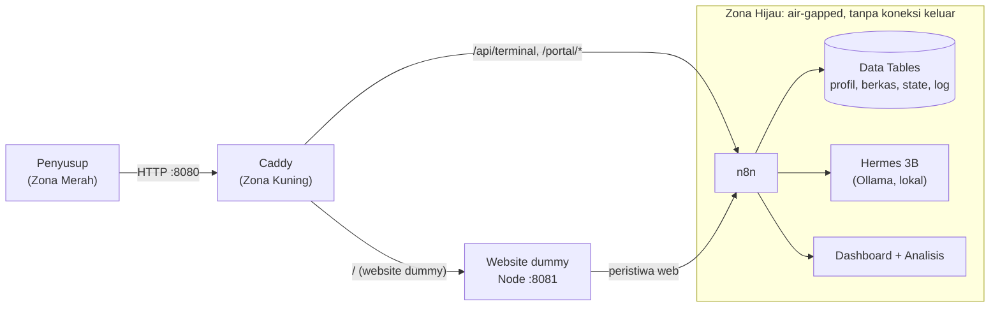

# Indrajala

**Jebakan siber berlapis yang menahan, merekam, dan menganalisis penyusup. Berjalan sepenuhnya lokal, tanpa internet.**

Purwarupa honeypot defensif untuk Cyber Range, dibuat untuk **Kartika Cyber Hackathon 2026** (Pusiberad TNI AD x CodePolitan).

| | |
|---|---|
| Video presentasi | **[URL video]** |
| Slide penjelasan | **[URL slide]** |
| Tim / peserta | **[Nama tim] / [Nama peserta]** |

> Seluruh entitas, alamat IP, kredensial, dan data di repositori ini **fiktif**. Tidak ada malware, dan tidak ada sistem nyata yang disentuh. Lihat [Keamanan dan etika](#keamanan-dan-etika).

---

## Ringkasan

Penyusup sering menjelajah jaringan berhari-hari sebelum ketahuan, dan alat pertahanan pasif hanya mencatat setelah kejadian. Indrajala memasang **umpan aktif** yang meyakinkan: server Linux palsu, website pemerintahan fiktif dengan fake login, dan dokumen umpan yang bisa dilacak. Siapa pun yang menyentuh umpan itu langsung memicu alarm, tercatat dengan IP-nya, dan dipetakan ke teknik **MITRE ATT&CK**.

Seluruh sistem berjalan di **satu laptop biasa** (RAM 8 GB, tanpa GPU) dengan perangkat gratis: n8n, Ollama (model Hermes 3B), Caddy, dan Node.js.

## Fitur utama

- **Terminal palsu** (Ubuntu 22.04). Perintah umum (`ls`, `cat`, `ps aux`, `ss`, `df`, dan lainnya) dijawab oleh **kode** secara konsisten, bukan ditebak AI. Perintah Linux lain diteruskan ke Hermes dengan penjaga keluaran.
- **Umpan berlapis**: catatan pegawai, `.env.bak` berisi kredensial umpan, lalu server backup kedua (`bkp-01`, Ubuntu 20.04) yang bisa dimasuki lewat SSH palsu (prompt sidik jari dan password).
- **Website dummy** (entitas fiktif) dengan **fake login**: SQL injection dibalas galat MySQL palsu, `' OR '1'='1` "berhasil" masuk ke portal pegawai palsu, `SLEEP(n)` benar-benar tertunda, boolean-blind mendapat jawaban berbeda. Ada **honey-link** (`robots.txt`, tautan tersembunyi, `/admin-backup/`).
- **Dokumen umpan berlacak tanpa internet**: PDF dibuat saat diunduh dengan **kode unik per unduhan**. Menekan tautan di dalamnya memicu alarm KRITIS yang terhubung ke sesi si pengunduh.
- **Honeytoken**: kredensial umpan yang tidak punya fungsi sah. Dipakai di mana pun = penyusup (hampir tanpa false positive).
- **Dashboard** (alarm otomatis, waktu tertahan, kedalaman rantai umpan, IP asal) dan **halaman Analisis** per penyusup (pemetaan ATT&CK pasti + ringkasan Hermes).
- **Pintu depan Caddy**: hanya empat jalur diteruskan, ciri server dipalsukan (Apache/PHP), IP asli dicatat dan header IP palsu ditolak.

## Arsitektur



| Zona | Isi | Aturan |
|---|---|---|
| Merah | Penyusup (browser, curl, pemindai) | Hanya melihat satu pintu depan |
| Kuning (DMZ) | Caddy `:8080` + website dummy `127.0.0.1:8081` | Hanya meneruskan jalur yang diizinkan |
| Hijau | n8n + Ollama + Data Tables + dashboard | Satu arah dari Kuning ke Hijau, tanpa koneksi keluar |

**Prinsip rancangan:** keputusan deteksi dan respons dibuat oleh **kode yang deterministik**. AI (Hermes) hanya dipakai sebagai cadangan terminal dan untuk **meringkas fakta hasil hitungan** di halaman Analisis. Hermes tidak punya alat, tidak ada di jalur login (terlalu lambat di CPU), dan tidak pernah menerima teks mentah dari penyusup pada analisis. Dengan begitu prompt injection tidak bisa mengubah alarm atau tabel bukti. Rincian ada di [docs/ARSITEKTUR.md](docs/ARSITEKTUR.md).

## Contoh skenario serangan

1. Penyusup membuka website, membaca `robots.txt`, lalu menemukan `/admin-backup/`.
2. Ia mencoba SQL injection di `/login.php` dan "berhasil" masuk. Alarm SQL injection menyala.
3. Dari listing ia mengunduh `Rekap_Belanja_TI_Q3_2026.pdf` (kode unik dibuat saat itu) dan membuka tautan di dalamnya. Alarm **KRITIS** menyala atas nama IP-nya.
4. Di sisi terminal, ia membaca `.env.bak`, memakai kredensial umpan, dan masuk ke `bkp-01`. Alarm **KRITIS** lagi.
5. Analis membuka halaman Analisis: teknik ATT&CK (T1190, T1110, T1552.001, T1021.004, ...), garis waktu, dan ringkasan Hermes.

Panduan demo lengkap: [docs/DEMO.md](docs/DEMO.md).

## Mulai cepat

Prasyarat: Windows 10/11 (atau Linux/Mac), RAM 8 GB, Node.js LTS, n8n, Ollama, Caddy. Langkah rinci: **[docs/INSTALL.md](docs/INSTALL.md)**. Ringkasnya:

```text
1. ollama pull hermes3:3b
2. set N8N_LISTEN_ADDRESS=127.0.0.1  &&  npx n8n        (jendela 1)
3. impor 8 tabel dari n8n/tabel/*.csv, impor n8n/workflow/*.json, pilih ulang tabel, Publish
4. caddy run --config Caddyfile --adapter caddyfile     (jendela 2, dari folder caddy/)
5. node zona-kuning/zona_kuning.js                       (jendela 3)
```

## Struktur repositori

```text
.
├── README.md
├── docs/                 INSTALL, ARSITEKTUR, DEMO, KEAMANAN
├── n8n/
│   ├── workflow/         ekspor workflow n8n (JSON)
│   ├── kode/             kode setiap node Code (JavaScript)
│   └── tabel/            8 tabel Data Table (CSV): profil, berkas, proses, jawaban, state, log, canary, unduhan
├── zona-kuning/          website dummy (Node.js, tanpa dependensi)
├── caddy/                Caddyfile (pintu depan)
└── tests/                pengujian otomatis (npm test)
```

## Pengujian

```text
npm test        # butuh Node.js >= 18, tanpa dependensi lain
```

| Rangkaian | Pemeriksaan | Cakupan |
|---|---|---|
| `uji_terminal_state.js` | 48 | state sesi di tabel, SSH ke server kedua, batas laju, pembatas Hermes, penjaga keluaran, nama sesi berbahaya, kompatibilitas dashboard |
| `uji_website.js` | 42 | website dummy, fake login dan SQLi, honey-link, penyamaran header, batas isi dan laju, ketahanan saat n8n mati |
| `uji_umpan.js` | 18 | portal, PDF unik valid (xref), canary, dashboard, analisis ATT&CK |

**Catatan jujur:** pengujian otomatis menjalankan kode node n8n di simulasi (bukan di n8n sungguhan) dan website dengan n8n tiruan. Uji menyeluruh di n8n dan Caddy dilakukan secara manual mengikuti [docs/DEMO.md](docs/DEMO.md). Versi n8n yang dipakai: **[lengkapi]**.

## Keamanan dan etika

- Honeypot **defensif** untuk Cyber Range dan edukasi. Tidak ada malware. Website dan server palsu **tidak mengeksekusi SQL atau perintah apa pun**: semua jawaban adalah teks.
- Data fiktif: entitas "Pemerintah Kabupaten Nusantara Raya", IP `10.x`, kredensial umpan. **Jangan memasukkan data atau kredensial nyata.**
- Kaki halaman website menyatakan bahwa ini lingkungan simulasi. Jangan dipakai menyamar sebagai situs lembaga nyata.
- Password yang diketik penyusup tersimpan apa adanya di log. Jangan biarkan pengguna sungguhan memakai halaman ini.
- Rincian ancaman dan mitigasi: [docs/KEAMANAN.md](docs/KEAMANAN.md).

## Keterbatasan yang diakui

- Hermes 3B di CPU butuh 30 sampai 90 detik, sehingga tidak ditempatkan di jalur login. Perintah umum dijawab kode.
- Dokumen umpan terpicu **saat tautannya diklik**. PDF tidak memanggil balik otomatis di semua pembaca.
- IP penyusup hanya terbaca bila lewat Caddy (di balik NAT/VPN/Tor yang terlihat adalah IP keluarnya).
- Semua lalu lintas HTTP polos (cukup untuk lab).
- Pembatas laju bersifat perkiraan pada banjir sangat cepat; state sesi yang tumpang-tindih pada sesi yang sama masih "yang terakhir menang".
- Ini purwarupa **IT**. Umpan **OT** (protokol industri) belum ada dan menjadi bagian peta jalan.

## Peta jalan

1. **Cyber Range (sekarang):** uji dan pelatihan di laptop.
2. **Pilot terisolasi:** jaringan/VLAN terpisah, tim merah, model yang lebih besar (GPU), log permanen, batas laju di perantara.
3. **Integrasi:** SIEM, perizinan resmi satuan, HTTPS, serta **umpan OT** (emulasi protokol industri seperti Modbus) untuk pengamanan IT/OT.

## Kesesuaian dengan kriteria penilaian

| Kriteria | Di mana dijawab |
|---|---|
| Relevansi dan manfaat | Ringkasan, skenario, peta jalan (IT sekarang, OT di tahap berikutnya) |
| Inovasi teknis | Umpan berlapis, dokumen berlacak tanpa internet, AI hanya di sisi analisis, laptop biasa. Pembeda dari honeypot LLM lain (mis. Cowrie): lapisan respons otomatis terpadu (terminal, web, canary, ATT&CK) |
| Fungsionalitas purwarupa | [docs/DEMO.md](docs/DEMO.md), `npm test`, video |
| Kelayakan implementasi | [docs/INSTALL.md](docs/INSTALL.md): gratis, lokal, tanpa Docker/cloud; data diedit lewat tabel |
| Kualitas dokumentasi | README ini, `docs/`, slide, video |

## Lisensi

[MIT](LICENSE) © 2026 [Nama peserta]
